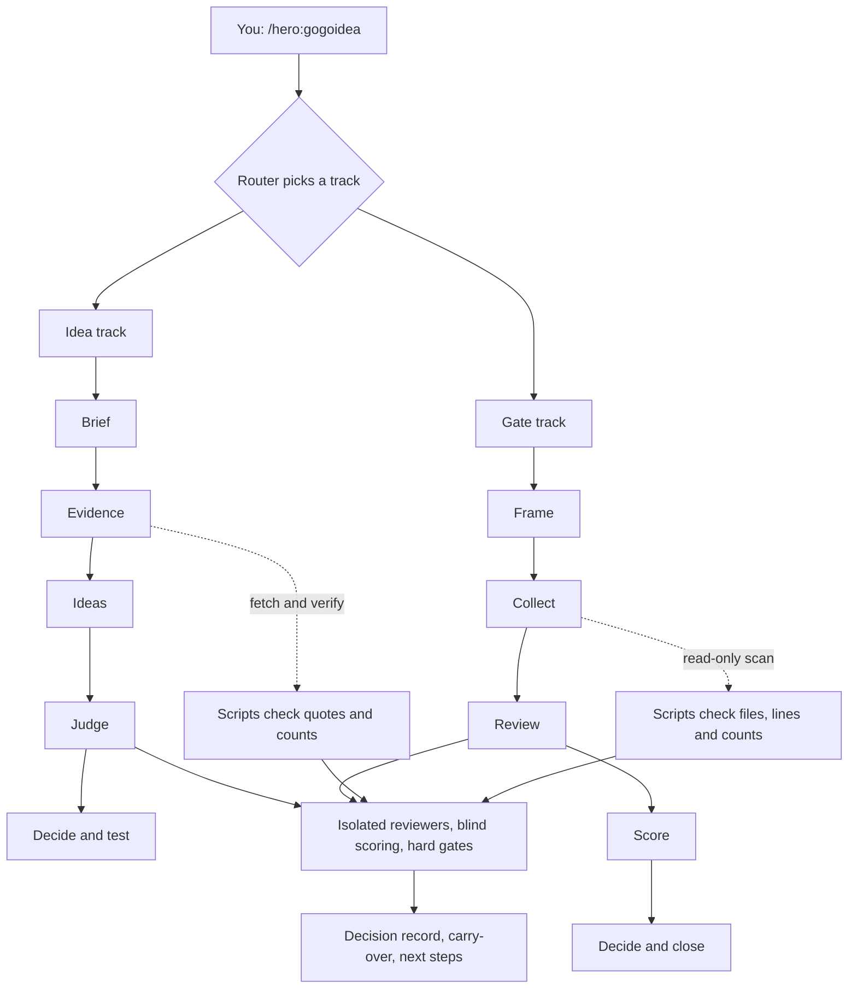

# GoGoIdea

**Two evidence-based go/no-go checkpoints for builders, behind one Claude Code command: `/hero:gogoidea`.**

| Track | The question | The result |
|---|---|---|
| **Idea** | What should I build? Is this idea worth building? | One stress-tested idea, or an honest "nothing survived", plus 7-day demand tests |
| **Gate** | Should we close this sprint, ship, and archive the build? | **GO**, **GO WITH CONDITIONS**, **NO-GO** or **ARCHIVE WITHOUT SHIP**, a prioritised carry-over list and an archive checklist |

A "no" is always a valid answer. Both tracks are built to avoid confident-sounding decisions that rest on thin evidence.

> Built by **Hero Minutes** with Claude Code. See the [case study](docs/CASE-STUDY.md) for how it was designed, tested against real runs, and corrected where testing found it wrong, and the [examples](examples/) for what it produces.

## How it works


### Idea track in 5 steps
It follows a design-strategy approach: start from real people's problems, diverge on ideas, then converge with independent judgement.
1. **Brief**: who you are, what you can build, your hours, money floor and constraints.
2. **Evidence**: collect public complaints, prices and switching behaviour; tag them; check there's enough.
3. **Ideas**: pitch through ten lenses, each citing evidence.
4. **Judge**: isolated roles (skeptic, economist, incumbent strategist, customer advocate, taste editor, builder, distribution, risk, premortem, red team) score blind; hard gates cut.
5. **Decide and test**: one winner or none, an answer-first memo, and 7-day tests with kill criteria.

### Gate track in 5 steps
1. **Frame**: sprint goal, product strategy and top priorities, what "done" means, product type and risk.
2. **Collect**: a read-only scan of the build, open issues, test results and feedback, and a walk through the core journey.
3. **Review**: ten lenses: strategy fit, security, privacy, auth, functionality, quality and bugs, user journey, UX design, data accuracy, release readiness. Each finding has a severity and evidence.
4. **Score**: evidence is verified by script, then a scorer reports blockers, a weighted score and a recommendation.
5. **Decide and close**: the chair rules, re-checks the load-bearing findings, and writes the decision record, carry-over list and archive checklist.

**Blockers beat scores.** An open critical issue means No-Go however good the average looks, and critical findings can't be "accepted away". Risks that do ship need a named owner and an expiry date. [Example: a build scores 68.3, would clear the bar, and is still NO-GO because of one critical issue.](examples/gate/01-first-gate/decision.md)

## Design principles
- **Evidence is checked by a script, not trusted.** Idea quotes must appear word for word in their source; Gate findings must cite a file and line that exist, or a count the script re-runs.
- **Reviewing and deciding are separate.** Reviewers work from an isolated packet that holds no one else's scores. The chair re-checks the claims that carry the decision.
- **Honest about gaps.** Unreviewed lenses make a Gate INCOMPLETE, never GO, and every decision record says what was not covered.
- **Contained and read-only.** The Gate never edits your repo and writes only to its own folder; the Idea track writes only to its own folder.

## What's been tested
- 50 unit tests for the scorers, verifier, scanner (including secret masking and "never writes to the target repo"), release tool and skill frontmatter. They are kept outside this repo.
- Two Idea runs on a sample brief over roughly 1,400 public reviews, posts and issues. The standard run ended with **no idea surviving**.
- A quick Gate on one real web project, checked independently: the project was byte-identical before and after, outputs stayed in the run folder, no secret appeared unmasked, and the scorer reproduced the same decision.
- The testing found and fixed ten defects, listed in the [case study](docs/CASE-STUDY.md).

## Examples
All invented data. See [`examples/`](examples/): a repo-scan sample, a first Gate that ends NO-GO, the re-gate after fixes that ends GO WITH CONDITIONS, and an Idea memo. The scanner, verifier and scorer output in them is real tool output on a fictional app.

## Install and use
```bash
claude plugin marketplace add herominutes/gogoidea
claude plugin install hero@hero-market
```
The plugin is `hero` and the skill is `gogoidea`, so you run it as **`/hero:gogoidea`** (plugin skills run as `/<plugin>:<skill>`). Or just ask: *"what should I build?"* or *"can we close this sprint?"* Pick a depth: **quick** (a screen), **standard** or **exhaustive**.

## What it does with your data
- **No server, nothing sent to the author.** Everything runs on your machine inside your Claude Code session.
- **Gate track:** reads your repo **read-only** and writes only to `gate-runs/<slug>/`. It makes no network calls, never edits your code, and doesn't build, test, install, tag or push unless you say yes. Secrets it finds are masked in outputs.
- **Idea track:** writes only to `council-runs/<slug>/`. Its script `fetch_sources.py` makes read-only requests to public APIs (Hacker News, Stack Exchange, GitHub search, Reddit's public JSON, Apple's iTunes feeds) with only your search queries and a generic User-Agent; no accounts or keys.
- Subagents (standard and exhaustive) run inside your own Claude session.

## Responsible use
- The Gate is **decision support, not certification**. It is not a penetration test, a legal or privacy review, or app-store approval, and it can only judge the evidence it's given.
- Idea-track runs quote public posts and reviews. Keep run outputs private or anonymise them; never publish a run folder.
- Public sources only, rate-limited, no logins. Respect each site's terms. Report complaints, not people.
- Test outreach should be honest, one message per person, and follow each community's rules.

## Limitations
- The Gate has been run on one real project in quick mode, plus synthetic builds. Real-world use will find gaps.
- The repo scan is a static pattern scan: it finds leads, not vulnerabilities, and finding nothing isn't proof of safety.
- Reddit is usually unreachable and web search returns summaries, not quotable text; app-store reviews skew toward angry leavers.
- Models share blind spots even when reviewers are isolated. Quick mode is a screen, not a decision.

## Contents
- `skills/gogoidea/SKILL.md`: the entry point and the two 5-step flows
- `skills/gogoidea/tracks/`: the detailed Idea and Gate workflows
- `skills/gogoidea/references/`: roles, rubric, frameworks, modes, sources, experiments and judge prompts; `references/gate/` has the lenses, decision rules, evidence guide, reviewer prompts and templates
- `skills/gogoidea/scripts/`: evidence fetching, quote and finding verification, scoring, and the read-only repo scan (standard library only; read them before you run them)
- `examples/` and `docs/CASE-STUDY.md`

## Credits and licence
The Idea track was inspired by a public social-media post describing an "idea council" style workflow, and by the widely taught practice of design strategy and human-centred design. This is an independent implementation with no affiliation to any author, company or design firm. The frameworks used (jobs-to-be-done, MECE issue trees, premortems, Kano, severity-based release gating, and others) are widely known methods, not any firm's proprietary material.

Licence: [MIT](LICENSE) © 2026 Hero Minutes. The software is provided as is, without warranty; its recommendations are decision support, not business, legal, security or financial advice.
