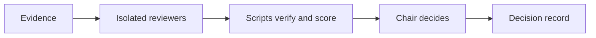

# Case study: building GoGoIdea

How a Claude Code plugin with two decision checkpoints was designed, tested against real runs, and corrected where testing found it wrong. Built with Claude Code, directed by Hero Minutes.

## The problem
Builders make two expensive calls on instinct:
- **What should I build?** Ideas usually come from vibes and are judged by whoever pitched them.
- **Can we close this sprint and ship?** "It looks fine" is easy to say when a deadline is near, and an average score can hide one critical flaw.

## The approach
One command, two tracks, with the same four rules in both:
1. **Honest outcomes.** "Nothing survived" and "No-Go" are valid results. Lists are never padded.
2. **Evidence is checked by a script, not trusted.** Idea quotes must appear word for word in their source. Gate findings must cite a file and line that exist, or a count the script re-runs.
3. **Separate reviewing from deciding.** Judges and reviewers work in isolation on a packet that contains no one else's scores; a chair decides and re-checks the load-bearing claims.
4. **Blockers beat scores.** Any open critical issue means No-Go, whatever the average, and critical findings cannot be "accepted away".

## What was built
- A **router** skill that picks the track and shows a 5-step flow for each.
- An **Idea track**: public-evidence scouts and miners, ten ideation lenses, isolated judges, hard gates, a red team, an answer-first memo and pre-registered 7-day tests.
- A **Gate track**: ten review lenses (strategy fit, security, privacy, auth, functionality, quality, journey, UX, data accuracy, release readiness), severity levels, scoring profiles, a priority formula, a decision record, a carry-over list, a risk register that needs an owner and an expiry, and an archive checklist.
- **Scripts** (Python standard library only): evidence fetching with caps, quote verification, evidence stats with a sufficiency gate, idea and gate scoring, a read-only repo scanner that masks secrets, and a finding verifier.
- A **release tool** that builds a clean, privacy-audited public copy and never pushes anything.

## How it was tested
- **Unit tests:** 50, covering the scorers, the verifier, the scanner (secret masking, no writes to the target repo), the release tool, and a YAML-validity check on the skill file. They are not part of this repo.
- **Two Idea runs** on a sample brief: roughly 1,400 public app-store reviews, forum posts and issue threads, 831 tagged pain items, ten ideas, ten isolated judge agents. The standard run ended with **no idea surviving**.
- **A quick Gate on a real web project**, read-only, then checked independently: the project was byte-identical before and after; every output stayed inside the run folder; no secret appeared unmasked; the scorer re-run gave the identical decision; and the top finding was confirmed in the actual file.

## What testing caught
| Problem found | Fix |
|---|---|
| A paid migration tool "won" a quick Idea run; the standard run killed it because free tools already did the job | Quick mode is documented as a screen, and the incumbent role must search for free substitutes first |
| A run collected about 1,100 rows against a target of about 100 | Collection caps (`--max-items`), a noise filter (`--signal`) and per-mode budgets |
| Miners labelled "switch intent" inconsistently on hedged wording like "considering" | An explicit rule: only completed or firmly decided actions count |
| One-time prices were ambiguous in pitches | A structured price field with an explicit model (monthly, annual, one-time, per-use) |
| The router's description contained a colon followed by a space, which makes the YAML frontmatter invalid. The plugin validator missed it; the skill validator caught it | A regression test that checks every skill file |
| The scanner flagged `sessionStorage` as sensitive because it contains "session" | Fixed, with a test |
| A reviewer reported "0 matches" in a real project; the true count was 1 | `count` evidence that `verify_findings.py` re-runs; the replayed claim now fails |
| After a bare "Go." the Gate drafted a code patch, which is outside its remit | A rule that a bare "go" approves only the proposed step, and fixes are offered, never written unprompted |
| A reviewer's "how we verify" check would have failed even after a correct fix | The chair must try each check against the current state first |
| A privacy audit found a third party's example idea reused in the docs | Removed, and the release tool now audits for this class of leak |

## Design decisions and trade-offs
- **One skill, two tracks** behind a single entry point, instead of two skills: one command to remember, at the cost of a slightly larger router.
- **Plugin `hero`, skill `gogoidea`** so the command is `/hero:gogoidea` and more skills can later share the brand; a generic plugin name could collide with another.
- **No network in the Gate.** It reads the repo read-only and writes only to its own folder, so it is safe to point at a private project.
- **Scripts decide the arithmetic, models decide the judgement.** The recommendation is deterministic; the findings behind it are not, which is why they are verified.

## Limitations
- The Gate has been run on **one** real project in quick mode, plus synthetic builds; more real runs will find gaps.
- Models share blind spots even when reviewers are isolated. Quick mode is a screen, not a decision.
- The repo scan is a static pattern scan. It finds leads, not vulnerabilities, and finding nothing is not proof of safety. The Gate is not a penetration test, a legal review or app-store approval.
- The Idea track's evidence is skewed toward app-store reviews and public forums; Reddit and private groups were unreachable.

## What's next
More real Gate runs at standard depth with isolated reviewers; stack-specific checks (for example backend policies and in-app purchases); and an update mode for the release tool.
